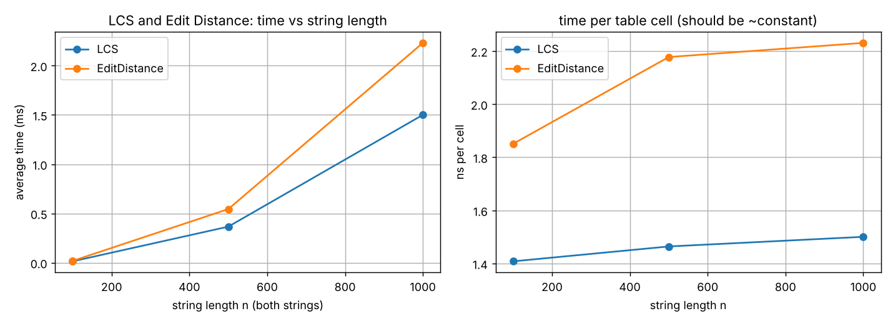
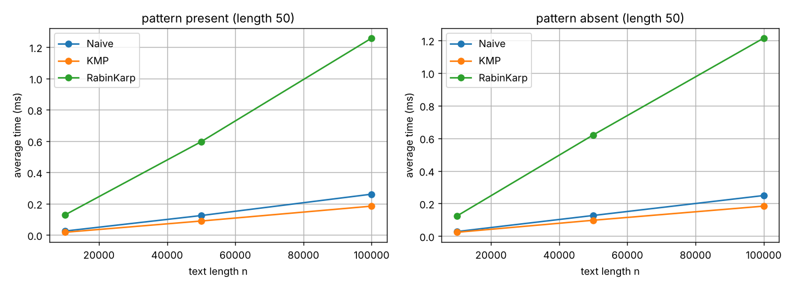
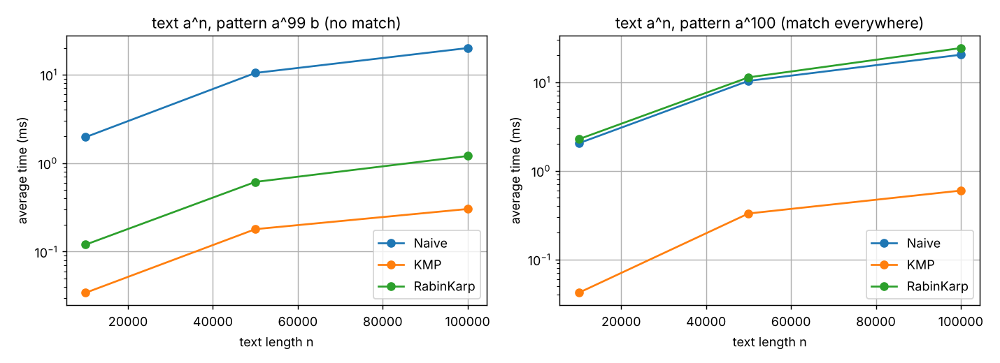
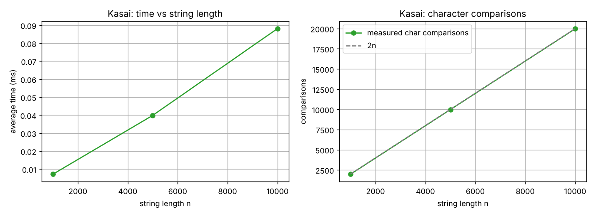

# Assignment 4 — Text Analysis: Dynamic Programming and String Algorithms

Duman Zhanybekov, SE-2530, Astana IT University

Java project that implements LCS, Edit Distance, Naive / KMP / Rabin–Karp string matching and Kasai's LCP algorithm, tests them and compares them experimentally. This README is the full report.

## Table of contents
1. [Problem description and algorithm overview](#1-problem-description-and-algorithm-overview)
2. [Implementation decisions and assumptions](#2-implementation-decisions-and-assumptions)
3. [Complexity analysis](#3-complexity-analysis)
4. [Why the algorithms work](#4-why-the-algorithms-work)
5. [Testing strategy and results](#5-testing-strategy-and-results)
6. [Experimental setup and timing methodology](#6-experimental-setup-and-timing-methodology)
7. [Results (tables and plots)](#7-results-tables-and-plots)
8. [Discussion: theory vs experiments](#8-discussion-theory-vs-experiments)
9. [Conclusion](#9-conclusion)
10. [How to build and run](#10-how-to-build-and-run)

---

## 1. Problem description and algorithm overview

The task is to analyse text with dynamic programming and string algorithms, check them with tests, and measure them. Everything is implemented by hand, no library methods are used for the algorithms (only `ArrayList`, `Random`, `Arrays.sort` for the test suffix array, `System.nanoTime`).

**Part A – dynamic programming** (`src/main/java/dp`)
- **LCS** – length of the longest subsequence that appears (not necessarily contiguous) in both strings. I also added `build()` which walks back through the table and returns one actual LCS string.
- **Edit Distance (Levenshtein)** – minimum number of insertions, deletions and substitutions to turn string `a` into string `b`.

**Part B – string matching** (`src/main/java/matching`)
- **Naive** – try every alignment of the pattern and compare char by char.
- **KMP** – builds the LPS (prefix function) table of the pattern, then never moves the text pointer backwards.
- **Rabin–Karp** – compares rolling hashes of the pattern and of each text window, and only compares characters when the hashes are equal.

All three return a list of **all** starting indices (overlapping matches included).

**Part C – advanced** (`src/main/java/suffix`)
- **Kasai's algorithm** – builds the LCP array from a string and its suffix array in linear time.
- `SimpleSA` is just a naive suffix array builder (sort all suffixes) so I can generate test input. It is not part of the required algorithms and it is never timed.

## 2. Implementation decisions and assumptions

- **Alphabet:** lowercase English letters `a–z` (26 symbols) for every randomly generated string. The only exception is the "absent" pattern, which has one `#` at the end (see below), and the extra bad-case experiment which uses only `a`/`b`.
- **Random seed:** fixed. `Random(42)` and `Random(43)` for the two DP strings, `Random(44)` for the matching text, `Random(45)` for Kasai strings. Same seed for different sizes means the shorter string is a prefix of the longer one.
- **Empty pattern:** all three matchers return an **empty list**. (Mathematically an empty pattern matches at every position, but I decided it is not a useful answer, and the important thing is that the three algorithms agree.) The same holds for a pattern longer than the text and, since nothing can match, for an empty text.
- **Overlapping matches** are reported (`"aaaaa"`, `"aa"` gives `[0, 1, 2, 3]`).
- **Case sensitive**, characters are compared as Java `char`s.
- **Rabin–Karp hash:** polynomial hash, base 256, modulus 1,000,000,007, kept in `long`. When two hashes are equal I verify the window character by character, so the result is always exact. The modulus is a parameter of `search(text, pattern, mod)` so the tests can use a tiny modulus (7) to force collisions.
- **DP tables:** both DP algorithms keep the full `(n+1) x (m+1)` `int` table. For the length/distance only, two rows would be enough (O(min(n,m)) space), but the full table is simpler to explain and is needed to rebuild the LCS string.
- **Kasai:** `lcp[i]` = length of the longest common prefix of the suffixes `sa[i-1]` and `sa[i]`, and `lcp[0] = 0`.
- **Operation counts:** every algorithm has public static counters (table cells filled, character comparisons, LPS comparisons, hash updates, false positives). They are reset at the start of each call.
- **Tests without JUnit:** I wanted the project to compile with plain `javac` and no dependencies, so the tests are in a small `TestRunner` class with a `check()` method and a `main()`. It exits with code 1 if anything fails. (It would be easy to move the cases into JUnit.)

## 3. Complexity analysis

n = text length (or length of the first string), m = pattern length (or length of the second string), k = number of matches.
Everything here is **theoretical**. Measured times are in sections 7 and 8.

| Algorithm | Main operation / recurrence | Best case time | Worst case time | Auxiliary space | Why |
|---|---|---|---|---|---|
| **LCS** | `L[i][j] = L[i-1][j-1] + 1` if `a[i]==b[j]`, else `max(L[i-1][j], L[i][j-1])`; `L[0][*] = L[*][0] = 0` | Θ(nm) | Θ(nm) | Θ(nm) | Every one of the `(n+1)(m+1)` cells is filled once, O(1) work per cell, no early exit. Table is stored whole (O(min(n,m)) possible if only the length is needed). |
| **Edit Distance** | `D[i][j] = min(D[i-1][j]+1, D[i][j-1]+1, D[i-1][j-1] + (a[i]!=b[j]))`; `D[i][0]=i`, `D[0][j]=j` | Θ(nm) | Θ(nm) | Θ(nm) | Same table-filling argument: nm cells, constant work each (3 candidates). |
| **Naive matching** | for each shift `s`, compare `p[j]` with `t[s+j]` until mismatch | Θ(n) (about n−m+1 comparisons: first char mismatches at every shift) | Θ((n−m+1)·m) = O(nm) (e.g. `a^n` and `a^(m-1)b`) | O(1) (+ output list) | There are n−m+1 shifts and each can cost up to m comparisons. Random text is close to the best case (expected about n·(1+1/26+…) ≈ 1.04n comparisons). |
| **KMP** | LPS table, then on mismatch `j = lps[j-1]` without moving `i` back | preprocessing O(m), search Θ(n) | preprocessing O(m), search O(n) (at most 2n comparisons) | O(m) for the LPS table | `i` only goes forward. `j` goes up by one only when `i` goes up by one, and every other step lowers `j`, so there are at most 2n steps. The LPS table is built with the same argument in O(m). |
| **Rabin–Karp** | rolling hash `h = ((h - t[i]·B^(m-1))·B + t[i+m]) mod q`, verify only when hashes are equal | preprocessing O(m), search O(n + m) expected / when no hash hits | O(nm) worst case | O(1) (+ output list) | Hashing all windows is O(n) (O(1) per shift). Verification costs O(m) but only happens on a hash hit. With a good modulus false positives are very rare, so the expected cost is O(n+m) (plus O(m) per real match). If many windows have equal hash (collisions or many real matches) verification happens at almost every shift, giving O(nm). |
| **Kasai (LCP)** | `h` = current lcp; compare `s[i+h]` and `s[j+h]` with `j = sa[rank[i]-1]`, then `h--` | Θ(n) | Θ(n) | O(n) (`rank` and `lcp` arrays; the given suffix array not counted) | `h` never goes above n and goes down by at most 1 per outer step (n steps), so it can go up at most 2n times in total. So the inner `while` runs at most 2n times overall, O(n). Does not depend on the input. |

**Expected vs worst case.** Naive and Rabin–Karp have a big gap between typical and worst case (O(n) vs O(nm)), because their running time depends on the input (partial matches, or hash hits). KMP and Kasai have the same bound in all cases because their pointer moves are amortised. The DP algorithms always fill the whole table, so best = worst.

## 4. Why the algorithms work

### LCS recurrence
`L[i][j]` = LCS length of the first `i` chars of `a` and the first `j` chars of `b`.
- **Base:** if one prefix is empty the LCS is empty, so `L[0][j] = L[i][0] = 0`.
- **`a[i] == b[j]`:** there is always an optimal common subsequence that uses both of these last characters (if an optimal one doesn't, we can swap/add the matching last pair and get a subsequence at least as long). So `L[i][j] = L[i-1][j-1] + 1`.
- **`a[i] != b[j]`:** the two last characters can't both be the last character of the common subsequence, so at least one of them is not used. Dropping `a[i]` gives `L[i-1][j]`, dropping `b[j]` gives `L[i][j-1]`, and we take the better one.

Each cell only depends on the left, upper and upper-left cells, so filling row by row is a valid order. Optimal substructure and overlapping subproblems are why DP works here (plain recursion would be exponential).

### Edit distance recurrence
`D[i][j]` = minimal edits to turn the first `i` chars of `a` into the first `j` chars of `b`.
- **Base:** `D[i][0] = i` (delete `i` chars), `D[0][j] = j` (insert `j` chars).
- Look at the last character of the prefixes. The last edit is one of:
  - delete `a[i]`: cost `D[i-1][j] + 1`
  - insert `b[j]` at the end: cost `D[i][j-1] + 1`
  - match/substitute `a[i]` with `b[j]`: cost `D[i-1][j-1]` if equal, `+1` if different.
- The optimum is the minimum of the three, and the subproblems are independent, so the recurrence is correct.

### How KMP avoids repeated comparisons
`lps[i]` is the length of the longest proper prefix of `p[0..i]` that is also a suffix of it. When a mismatch happens at pattern index `j`, we already know that the last `j` text characters equal `p[0..j-1]`. The longest prefix of the pattern that could still match there is exactly `lps[j-1]`, so we set `j = lps[j-1]` and keep the same text index. The text pointer never goes back, so characters that were already matched are not compared again. After a full match we also do `j = lps[m-1]`, which finds overlapping matches.

### How Rabin–Karp handles collisions
Two different strings can have the same hash modulo `q`, so an equal hash is only a *candidate*. Each time the hashes are equal I compare the window and the pattern character by character. If they differ it is counted as a false positive and the search continues. This way the output is always exact, and a collision only costs time. In the tests with modulus 7 there are lots of false positives and the answers are still correct.

### What the LCP array is (Kasai)
The suffix array lists the starting indices of all suffixes in sorted order. The LCP array says how many characters neighbouring suffixes in that order share: `lcp[i] = LCP(suffix sa[i-1], suffix sa[i])`. Useful things that come from it: the longest repeated substring is `max(lcp)`, and the number of distinct substrings is `n(n+1)/2 − Σ lcp[i]`.

Kasai's idea: if suffix `i` has lcp `h` with its predecessor in the suffix array, then suffix `i+1` has an lcp of at least `h−1` with its own predecessor (drop the first character from both suffixes, their order stays the same). So after processing `i` we only decrement `h` by 1 instead of starting from 0, which gives the linear bound from section 3.

**Manual example – `banana`:**

| i | sa[i] | suffix | lcp[i] |
|---|---|---|---|
| 0 | 5 | `a` | 0 |
| 1 | 3 | `ana` | 1 (`a`) |
| 2 | 1 | `anana` | 3 (`ana`) |
| 3 | 0 | `banana` | 0 |
| 4 | 4 | `na` | 0 |
| 5 | 2 | `nana` | 2 (`na`) |

So `SA = [5, 3, 1, 0, 4, 2]` and `LCP = [0, 1, 3, 0, 0, 2]`. Check: the longest repeated substring is `ana` (max lcp 3), distinct substrings = 21 − 6 = 15.

## 5. Testing strategy and results

Tests are in `src/test/java/TestRunner.java`. Every string-matching test runs Naive, KMP, Rabin–Karp and Rabin–Karp with modulus 7, compares each with the expected list **and** checks that all lists are identical.

| Area | Cases covered |
|---|---|
| LCS | identical strings, completely different strings, first/second/both empty, two textbook examples (`ABCBDAB`/`BDCABA` = 4, `AGGTAB`/`GXTXAYB` = 4), `build()` returns a common subsequence of the right length |
| Edit Distance | identical, one empty (both directions), both empty, substitution (`cat`→`cut`), insertion (`cat`→`cart`), deletion (`cart`→`cat`), `kitten`/`sitting` = 3, `sunday`/`saturday` = 3, `intention`/`execution` = 5, symmetry |
| String matching | pattern at beginning, middle, end; multiple occurrences; overlapping occurrences; absent; absent but with a long partial match; pattern longer than text; empty pattern; empty text; pattern equal to text; single char pattern; classic KMP example; LPS table of `aabaaab` and `abcabc`; Rabin–Karp with tiny modulus really produces false positives |
| Kasai | `banana` with manually verified SA and LCP, `abab`, `aaaa`, single char, `SimpleSA("banana")` equals the manual SA |
| Randomised | 500 random cases comparing the 3 matchers with a brute force `startsWith` loop; 500 random strings where Kasai's output is compared with a brute force LCP; 500 random pairs where LCS / Edit Distance satisfy `|n−m| ≤ ED ≤ n+m−2·LCS` |

**Result:** `106 passed, 0 failed` (output of `java -cp out TestRunner`).

## 6. Experimental setup and timing methodology

| Experiment | Input | Sizes |
|---|---|---|
| LCS | two random strings of equal length | 100, 500, 1,000 |
| Edit Distance | same two strings as LCS | 100, 500, 1,000 |
| String matching | one random text, pattern length 50 | text 10,000 / 50,000 / 100,000 |
| Kasai | one random string + its suffix array from `SimpleSA` | 1,000 / 5,000 / 10,000 |

- **Alphabet / seeds:** `a–z`, fixed seeds (see section 2).
- **Patterns:** the *present* pattern is the substring `text[n/2 .. n/2+50)`. The *absent* pattern is the same substring with its last character replaced by `#`, which is not in the alphabet, so it can never occur but it still produces partial matches. The same text and pattern are given to Naive, KMP and Rabin–Karp.
- **Timing:** `System.nanoTime()` around only the algorithm call. Input generation, suffix array construction, result checking, console output and file writing are all outside the timed part.
- **Repetitions:** each configuration is run **5 times** and the **average** is reported. Before the 5 timed runs there is an untimed warm-up (at least 100 runs and at least 300 ms) so the JIT compiler has finished. (With only 2 warm-up runs my first attempt gave nonsense, e.g. LCS with n=100 slower than n=500 per cell.)
- **Operation counts:** taken from one extra untimed call. They don't change between runs.
- **Correctness check inside the benchmark:** Naive, KMP and Rabin–Karp must return the same list for every input or the benchmark throws, and the Kasai output is checked against a brute force LCP.
- **Extra experiment (not required):** two bad cases for text `a^n`, pattern length 100: *worstA* = pattern `a^99 b` (no match, long partial matches everywhere) and *worstB* = pattern `a^100` (matches at every position). These show the worst-case behaviour that random text doesn't.
- **Environment where the numbers in this README were produced:** Linux, Intel Xeon @ 2.30 GHz (1 vCPU), 4 GB RAM, OpenJDK 21. Absolute times will be different on another machine, the shapes should not.

## 7. Results (tables and plots)

All times are averages of 5 runs in milliseconds. Raw data is in `results/*.csv`, the console output of the run is in `results/console_output.txt`.

### 7.1 LCS and Edit Distance

| n | LCS time (ms) | Edit Distance time (ms) | table cells (n·n) |
|---|---|---|---|
| 100 | 0.014 | 0.019 | 10,000 |
| 500 | 0.366 | 0.544 | 250,000 |
| 1,000 | 1.501 | 2.231 | 1,000,000 |



### 7.2 String matching (required workloads)

Comparisons = character comparisons in the search phase (for KMP the LPS construction is listed separately, for Rabin–Karp these are the characters compared while verifying a hash hit; "hash updates" are rolling hash steps).

| case | n | algorithm | time (ms) | comparisons | LPS comparisons | hash updates | false positives | matches found |
|---|---|---|---|---|---|---|---|---|
| present | 10,000 | Naive | 0.025 | 10,389 | 0 | 0 | 0 | 1 |
| present | 10,000 | KMP | 0.018 | 10,373 | 50 | 0 | 0 | 1 |
| present | 10,000 | RabinKarp | 0.128 | 50 | 0 | 9,950 | 0 | 1 |
| absent | 10,000 | Naive | 0.028 | 10,389 | 0 | 0 | 0 | 0 |
| absent | 10,000 | KMP | 0.024 | 10,374 | 50 | 0 | 0 | 0 |
| absent | 10,000 | RabinKarp | 0.124 | 0 | 0 | 9,950 | 0 | 0 |
| present | 50,000 | Naive | 0.125 | 52,021 | 0 | 0 | 0 | 1 |
| present | 50,000 | KMP | 0.090 | 51,948 | 51 | 0 | 0 | 1 |
| present | 50,000 | RabinKarp | 0.596 | 50 | 0 | 49,950 | 0 | 1 |
| absent | 50,000 | Naive | 0.127 | 52,021 | 0 | 0 | 0 | 0 |
| absent | 50,000 | KMP | 0.098 | 51,949 | 51 | 0 | 0 | 0 |
| absent | 50,000 | RabinKarp | 0.620 | 0 | 0 | 49,950 | 0 | 0 |
| present | 100,000 | Naive | 0.261 | 103,936 | 0 | 0 | 0 | 1 |
| present | 100,000 | KMP | 0.185 | 103,785 | 50 | 0 | 0 | 1 |
| present | 100,000 | RabinKarp | 1.258 | 50 | 0 | 99,950 | 0 | 1 |
| absent | 100,000 | Naive | 0.249 | 103,936 | 0 | 0 | 0 | 0 |
| absent | 100,000 | KMP | 0.184 | 103,786 | 50 | 0 | 0 | 0 |
| absent | 100,000 | RabinKarp | 1.214 | 0 | 0 | 99,950 | 0 | 0 |



### 7.3 String matching, bad cases (extra)

| case | n | algorithm | time (ms) | comparisons | LPS comparisons | hash updates | false positives | matches found |
|---|---|---|---|---|---|---|---|---|
| worstA | 10,000 | Naive | 1.963 | 990,100 | 0 | 0 | 0 | 0 |
| worstA | 10,000 | KMP | 0.034 | 19,901 | 197 | 0 | 0 | 0 |
| worstA | 10,000 | RabinKarp | 0.120 | 0 | 0 | 9,900 | 0 | 0 |
| worstB | 10,000 | Naive | 2.039 | 990,100 | 0 | 0 | 0 | 9,901 |
| worstB | 10,000 | KMP | 0.042 | 10,000 | 99 | 0 | 0 | 9,901 |
| worstB | 10,000 | RabinKarp | 2.266 | 990,100 | 0 | 9,900 | 0 | 9,901 |
| worstA | 50,000 | Naive | 10.428 | 4,990,100 | 0 | 0 | 0 | 0 |
| worstA | 50,000 | KMP | 0.179 | 99,901 | 197 | 0 | 0 | 0 |
| worstA | 50,000 | RabinKarp | 0.612 | 0 | 0 | 49,900 | 0 | 0 |
| worstB | 50,000 | Naive | 10.304 | 4,990,100 | 0 | 0 | 0 | 49,901 |
| worstB | 50,000 | KMP | 0.329 | 50,000 | 99 | 0 | 0 | 49,901 |
| worstB | 50,000 | RabinKarp | 11.290 | 4,990,100 | 0 | 49,900 | 0 | 49,901 |
| worstA | 100,000 | Naive | 19.921 | 9,990,100 | 0 | 0 | 0 | 0 |
| worstA | 100,000 | KMP | 0.303 | 199,901 | 197 | 0 | 0 | 0 |
| worstA | 100,000 | RabinKarp | 1.202 | 0 | 0 | 99,900 | 0 | 0 |
| worstB | 100,000 | Naive | 20.306 | 9,990,100 | 0 | 0 | 0 | 99,901 |
| worstB | 100,000 | KMP | 0.597 | 100,000 | 99 | 0 | 0 | 99,901 |
| worstB | 100,000 | RabinKarp | 24.153 | 9,990,100 | 0 | 99,900 | 0 | 99,901 |



(log scale on the y axis)

### 7.4 Kasai's algorithm

| n | time (ms) | character comparisons | 2n (theoretical bound) |
|---|---|---|---|
| 1,000 | 0.007 | 1,972 | 2,000 |
| 5,000 | 0.040 | 9,971 | 10,000 |
| 10,000 | 0.088 | 19,970 | 20,000 |



## 8. Discussion: theory vs experiments

**LCS and Edit Distance.** Theory says Θ(nm), so with equal lengths the time should grow with n². When n goes from 500 to 1,000 the number of cells goes up 4× and the time goes up about 4.1× for LCS (0.366 → 1.501 ms) and 4.1× for Edit Distance (0.544 → 2.231 ms). The time per cell stays about the same (≈1.4–1.5 ns for LCS and ≈1.9–2.2 ns for Edit Distance, right plot), which is what a constant amount of work per cell predicts. Edit Distance is about 1.5× slower than LCS because each cell takes a minimum of three values and the borders have to be initialised. Both fill exactly n·m cells, matching the table-cell counters. The n=100 point is only 14–19 µs so it is mostly noise and warm-up effects.

**String matching on random text.** For random text over 26 letters, Naive and KMP are both linear and do almost the same number of comparisons (about 1.04n: 103,936 vs 103,785 for n = 100,000). This is the "expected case" for Naive: most shifts fail at the first character, so the O(nm) worst case never shows up. KMP's advantage is therefore not visible in the counters here. In wall-clock time KMP was a bit faster than Naive (0.185 vs 0.25 ms at 100,000), but the comparison counts are nearly equal so I can't say this is because of the algorithm, it is probably the code shape (JIT, branches), I did not investigate. Present vs absent patterns made no difference, since both algorithms scan the whole text (they have to, to find every occurrence).

**Rabin–Karp was the slowest** in the required workloads (≈1.2 ms vs ≈0.2 ms at n = 100,000, roughly 5–7×) even though it compares only 50 characters (present) or 0 characters (absent). Its search is still linear (99,950 hash updates for n = 100,000, time doubles when n doubles), but every window costs two modulo operations and several multiplications, which is much more than one character comparison. No false positives happened with modulus 10⁹+7 in these runs (`false_pos = 0`). This is a good reminder that the same big-O can hide a very different constant.

**Bad cases (extra).** Here the theory shows up clearly:
- **Naive** made 9,990,100 comparisons for n = 100,000, which is exactly (n−m+1)·m = 99,901·100, and took about 20 ms, around 65× slower than KMP (0.3 ms). Its time grows linearly with n here because m is fixed at 100; it would grow with m too.
- **KMP** made 199,901 comparisons in worstA, which is about the 2n upper bound, and exactly n (100,000) in worstB. It never goes above 2n.
- **Rabin–Karp** was fast in worstA (the hashes never match because the pattern ends in `b`), but in worstB every window is a real match, so every window is verified: 9,990,100 comparisons and 24 ms, the O(nm) behaviour (slightly worse than Naive because of the hashing on top). This worst case is not a collision problem; it comes from matches being everywhere, but frequent collisions would have the same effect.

**Kasai.** Time went 0.007 → 0.040 → 0.088 ms for n = 1,000 / 5,000 / 10,000, which is roughly linear (5× the size gives 5.7× the time, 2× gives 2.2×). The comparison counter is the cleaner evidence: 1,972 / 9,971 / 19,970 comparisons, always just under the 2n bound from the amortised argument. The times are tiny (microseconds), so cache effects and timer noise are a big part of them. The suffix array construction (naive sort) is much slower than Kasai itself, but it is not timed and not part of the assignment.

**Reliability of the measurements.** Repeating the whole benchmark several times in separate JVM runs gave results within about 10–15% of each other, so the conclusions above (ratios of 4×, 5–7×, 65×) are not affected, but the small absolute values (a few microseconds) should not be over-interpreted. The operation counts are deterministic, so I consider them stronger evidence for the theory than the times.

## 9. Conclusion

- **LCS / Edit Distance:** both are Θ(nm) time and space with this table version; the experiments confirm quadratic growth with constant cost per cell. The price of DP is memory (1,000 × 1,000 table = 1M ints). If only the number is needed, keeping two rows reduces the space to O(min(n,m)); the full table is only needed to reconstruct the actual subsequence / edit script.
- **Naive:** simplest and has no preprocessing or extra memory; fine on random text (≈n comparisons) but Θ(nm) on repetitive text.
- **KMP:** guaranteed O(n+m) whatever the input, at the cost of an O(m) table and a trickier implementation. It is the safe choice when the input can be repetitive or adversarial, though on random text it is not noticeably better than Naive.
- **Rabin–Karp:** O(n+m) expected with O(1) extra space, and its idea extends easily to searching many patterns at once, but its constant is high (arithmetic per character) and it has an O(nm) worst case with many collisions or matches. It was the slowest here for a single pattern.
- **Kasai:** builds the LCP array in guaranteed O(n) time with O(n) extra space once a suffix array is available; the work is bounded by 2n comparisons regardless of the string. The real cost of the pipeline is building the suffix array, not the LCP.
- **Theory vs practice:** big-O predicted the shapes well (quadratic DP, linear matchers and Kasai, Naive/RK blow-up in the bad cases), but it didn't predict that Rabin–Karp would be several times slower than Naive on random text, so constants matter when n is only 10⁴–10⁵.

## 10. How to build and run

Needs a JDK (I used OpenJDK 21) and, for the plots only, Python 3 with `matplotlib`. Run everything from the repository root.

```
javac -d out -sourcepath src/main/java src/main/java/bench/Bench.java src/test/java/TestRunner.java
java -cp out TestRunner          # runs all tests
java -cp out bench.Bench         # runs experiments, writes results/*.csv
python3 plots/make_plots.py      # makes the png files in plots/
```

(`run_all.sh` / `run_all.bat` do the same four steps.) `bench.Bench` must be started from the repository root because it writes into `results/`. Running the benchmark takes about 20–30 seconds.

**Repository layout**
```
src/main/java/dp/         LCS.java, EditDistance.java
src/main/java/matching/   Naive.java, KMP.java, RabinKarp.java
src/main/java/suffix/     Kasai.java, SimpleSA.java
src/main/java/bench/      Bench.java  (all experiments)
src/test/java/            TestRunner.java
results/                  dp.csv, matching.csv, matching_worst.csv, kasai.csv, console_output.txt
plots/                    make_plots.py and the png plots
```
